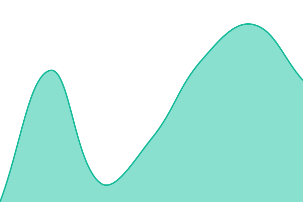

# Status

Uptime monitor and status page for my apps, powered by [Upptime](https://upptime.js.org).
GitHub Actions checks each site every 5 minutes and commits the results to this repository.
The Life Dashboard reads `history/summary.json`.

<!--start: status pages-->
<!-- This summary is generated by Upptime (https://github.com/upptime/upptime) -->
<!-- Do not edit this manually, your changes will be overwritten -->
<!-- prettier-ignore -->
| URL | Status | History | Response Time | Uptime |
| --- | ------ | ------- | ------------- | ------ |
|  [Dirt Map](https://dirt-map.vercel.app) | 🟩 Up | [dirt-map.yml](https://github.com/abadadria/status/commits/HEAD/history/dirt-map.yml) | 

 869ms
     
 | 

<a href="https://abadadria.github.io/status/history/dirt-map">100.00%</a>
    

|  [ENERQ](https://www.enerq.es) | 🟩 Up | [enerq.yml](https://github.com/abadadria/status/commits/HEAD/history/enerq.yml) | 

 274ms
     
 | 

<a href="https://abadadria.github.io/status/history/enerq">100.00%</a>
    

|  [Life Dashboard](https://life-dashboard-two-peach.vercel.app/login) | 🟩 Up | [life-dashboard.yml](https://github.com/abadadria/status/commits/HEAD/history/life-dashboard.yml) | 

 634ms
     
 | 

<a href="https://abadadria.github.io/status/history/life-dashboard">100.00%</a>
    

|  [SPADEWORK](https://spadeworkapp.com) | 🟩 Up | [spadework.yml](https://github.com/abadadria/status/commits/HEAD/history/spadework.yml) | 

 201ms
     
 | 

<a href="https://abadadria.github.io/status/history/spadework">100.00%</a>
    

<!--end: status pages-->

## Setup (one time)

1. **Settings > General**: the repository must be public (free Actions minutes).
2. **Settings > Actions > General > Workflow permissions**: select **Read and write permissions**.
3. Recommended: add a fine-grained token as the secret `GH_PAT`
   (only this repository; Actions, Contents, Issues, Workflows = Read and write).
   Without it, Upptime cannot open issues for incidents or update its own workflow files.
4. **Actions** tab: run the **Setup CI** workflow one time.
5. **Settings > Pages**: source = branch `gh-pages`. The page is then at <https://abadadria.github.io/status>.

## Add or change a site

Edit [`.upptimerc.yml`](.upptimerc.yml). Do not edit `.github/workflows/`; Upptime generates those files.

## License

- Upptime code: [MIT](./LICENSE) © [Anand Chowdhary](https://anandchowdhary.com)
- Data in `history/`: [Open Database License](./history/LICENSE)
